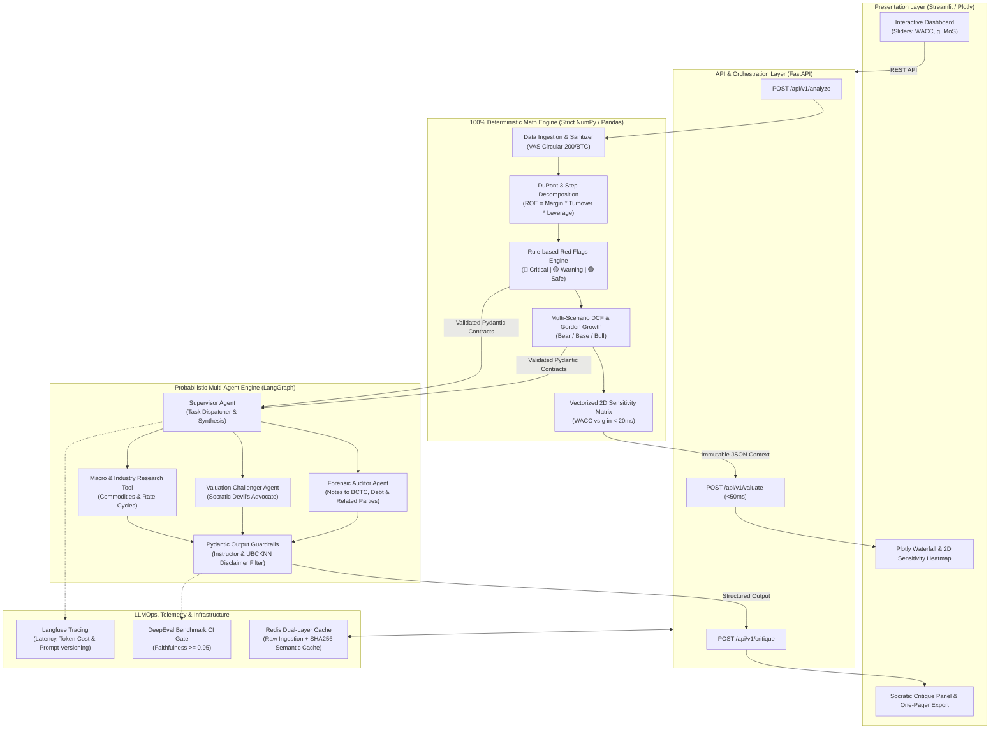

# ValueInvest-Engine 🚀

> **Quantitative Financial Analysis, Multi-Agent Risk Auditing & LLMOps Platform**  
> *A Production-Grade Decoupled FinTech Architecture Solving Math Hallucination in Equity Research.*

---

[](https://github.com/ThanhTan2k6/ValueInvest-Engine/actions)
[](https://www.python.org/downloads/)
[](https://github.com/astral-sh/ruff)
[](https://github.com/confident-ai/deepeval)
[](docker-compose.yml)
[](LICENSE)

---

## 1. Executive Summary & Problem Statement

Hầu hết các giải pháp Generative AI / LLM Chatbot phổ thông khi áp dụng vào tài chính đều gặp lỗi chí mạng: **Ảo giác Số học (Math Hallucination)**. Khi được yêu cầu tính toán ROE, WACC, dòng tiền tự do (FCF) hay định giá chiết khấu DCF, LLM thường tự "bịa" số liệu hoặc nhầm lẫn công thức, gây rủi ro phá sản hoặc mất vốn nghiêm trọng nếu ứng dụng vào thực tế giải ngân.

**ValueInvest-Engine** giải quyết triệt để vấn đề này bằng kiến trúc **Decoupled Engine** (Phân tách 100% giữa Tính toán Số học Quyết định và Trí tuệ Nhân tạo Đa tác tử):
1. **Deterministic Math Engine (100% Python/NumPy/Pandas):** Đảm nhiệm toàn bộ việc tính toán số học tài chính chuẩn mực theo Thông tư 200/2014/TT-BTC, quét bẫy kế toán định lượng (Traffic Light Red Flags), và render Ma trận độ nhạy 2 chiều ($WACC$ vs $g$) trong $< 50\text{ms}$.
2. **Agentic AI & Socratic Devil's Advocate (LangGraph Multi-Agent):** Đóng vai trò Hội đồng Thẩm định Độc lập, phân tích Thuyết minh BCTC và dùng kỹ thuật thẩm vấn Socrate (Socratic Questioning) để bẻ gãy các giả định màu hồng của nhà đầu tư trước khi xuống tiền.
3. **LLMOps & Telemetry Pipeline (Langfuse + DeepEval + Redis):** Kiểm định tự động điểm số **Faithfulness $\ge 0.95$** (chặn đứng mọi số liệu ảo giác), tích hợp Redis Semantic Cache đưa thời gian phản hồi về dưới $0.2\text{s}$.

---

## 2. System Architecture



---

## 3. Key Technical Highlights & CV Highlights

* **Kiến trúc Decoupled Độc đáo (Zero Math Hallucination):** Tầng Math/Valuation được cách ly hoàn toàn, cấm import bất kỳ thư viện LLM nào (`langchain`, `openai`, `instructor`).
* **NumPy Vectorized 2D Sensitivity:** Render ma trận độ nhạy $10 \times 10$ trong dưới $20\text{ms}$ bằng kỹ thuật NumPy 3D Broadcasting, mang lại trải nghiệm kéo thả slider thời gian thực trên Streamlit.
* **Tư duy Phản biện Socrate (Socratic Devil's Advocate):** Tác tử AI không nịnh người dùng, mà đặt ra 3 câu hỏi hóc búa đối chiếu giả định tương lai với các giới hạn năng lực thực tế trong quá khứ.
* **LLMOps CI Quality Gate:** CI pipeline trên GitHub Actions tự động kiểm định: Linting sạch với Ruff, Unit Test coverage $> 80\%$, và DeepEval Faithfulness $\ge 0.95$ trên bộ 10 Golden Cases BCTC thực tế tại Việt Nam.

---

## 4. Quickstart Guide (1-Click Run)

### Cách 1: Khởi chạy 1 lệnh bằng Docker Compose (Khuyên dùng)
```bash
# Clone repository
git clone https://github.com/ThanhTan2k6/ValueInvest-Engine.git
cd ValueInvest-Engine

# Cấu hình biến môi trường
cp .env.example .env
# Điền OPENAI_API_KEY và LANGFUSE keys vào .env

# Khởi chạy toàn bộ hệ thống (App + Redis Cache)
docker-compose up --build
```
* **Streamlit Dashboard:** `http://localhost:8501`
* **FastAPI Docs (Swagger UI):** `http://localhost:8000/docs`

---

### Cách 2: Khởi chạy Cục bộ qua Makefile
```bash
# 1. Cài đặt môi trường
make install

# 2. Kiểm tra chất lượng mã nguồn & Ranh giới kiến trúc
make lint

# 3. Chạy unit tests toán học
make test

# 4. Chạy Streamlit UI
make run-ui
```

---

## 5. Cấu trúc Dự án (Repository Layout)

```
ValueInvest-Engine/
├── .cursorrules                      # Bộ luật bất di bất dịch về ranh giới kiến trúc
├── CLAUDE.md                         # Quy chuẩn coding & commit cho AI Assistants
├── Makefile                          # Task runner tự động hóa (test, lint, run, docker)
├── pyproject.toml                    # Cấu hình dependencies, Ruff linter & Pytest
├── docker-compose.yml                # Docker orchestration (App + Redis)
├── Dockerfile                        # Multi-stage build cho Python 3.11
├── .github/
│   ├── CONTRIBUTING.md               # Quy định GitHub Flow & Conventional Commits
│   ├── PULL_REQUEST_TEMPLATE.md      # Checklist ranh giới Decoupled trước khi merge
│   └── workflows/ci.yml              # CI Quality Gate (Lint -> Test -> Eval -> Docker)
├── .agents/skills/                   # Hướng dẫn kỹ năng chuyên biệt cho AI Agents
│   ├── skill_quant_math.md           # Kỹ thuật toán tài chính & vectorization
│   ├── skill_forensic_redflags.md    # Định lượng bẫy kế toán & trích xuất Thuyết minh
│   ├── skill_multi_agent_langgraph.md# Thiết kế StateGraph & Socratic questioning
│   └── skill_llmops_evals.md         # Langfuse tracing & DeepEval faithfulness
├── .specs/                           # Bản đặc tả kỹ thuật chi tiết
│   ├── spec_00_use_cases.md          # 5 Core Use Cases & Edge Cases matrix
│   ├── spec_01_data_contracts.md     # Pydantic v2 schemas đầy đủ
│   ├── spec_02_agent_prompts.md      # Production system prompts cho 3 tác tử
│   └── spec_03_eval_and_golden_dataset.md # 10 Golden Cases HOSE/HNX & CI Gate
├── docs/                             # Tài liệu kiến trúc chuyên sâu
│   ├── accounting_mapping_tt200.md   # Bảng ánh xạ chỉ tiêu Thông tư 200 sang Pydantic
│   ├── api_and_state_design.md       # Đặc tả REST API & Quản lý State Sub-0.1s
│   └── adr/
│       └── 001_decoupled_architecture_and_llmops.md # Bản ghi quyết định kiến trúc
├── data/
│   ├── raw/                          # BCTC Excel/JSON thô (git ignored)
│   └── golden_eval/cases.json        # 10 Golden Test Cases kiểm chuẩn LLM
├── src/
│   ├── ingestion/                    # Thu thập & Chuẩn hóa BCTC (Thông tư 200)
│   ├── engine/                       # Deterministic Financial Engine (100% Math)
│   ├── valuation/                    # DCF Multi-Scenario & 2D Sensitivity Matrix
│   ├── agents/                       # LangGraph Multi-Agent Collaboration
│   ├── llmops/                       # Langfuse Tracing, Redis Cache & Guardrails
│   └── ui/                           # Streamlit Interactive Presentation Layer
└── tests/                            # Pytest Unit, Integration & Faithfulness Tests
```

---

## 6. Regulatory Financial Disclaimer

> **TUYÊN BỐ MIỄN TRỪ TRÁCH NHIỆM PHÁP LÝ (MANDATORY DISCLAIMER):**  
> *Hệ thống `ValueInvest-Engine` được xây dựng hoàn toàn cho mục đích học thuật, nghiên cứu định lượng độc lập và kiểm toán rủi ro theo phương pháp luận đầu tư giá trị. Hệ thống **tuyệt đối không** đưa ra bất kỳ khuyến nghị mua/bán, cam kết lợi nhuận hay lời khuyên đầu tư tài chính trực tiếp theo quy định của Ủy ban Chứng khoán Nhà nước (UBCKNN). Mọi quyết định giải ngân vốn trên thị trường chứng khoán thuộc về trách nhiệm duy nhất của nhà đầu tư.*

---

## 7. License & Author

- **Author:** Thanh Tan ([@ThanhTan2k6](https://github.com/ThanhTan2k6))
- **Role:** Quantitative FinTech & AI Systems Engineer
- **License:** Distributed under the MIT License. See `LICENSE` for more information.
